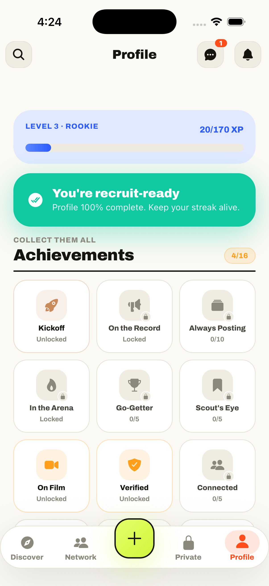
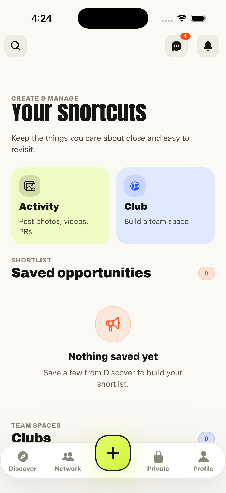
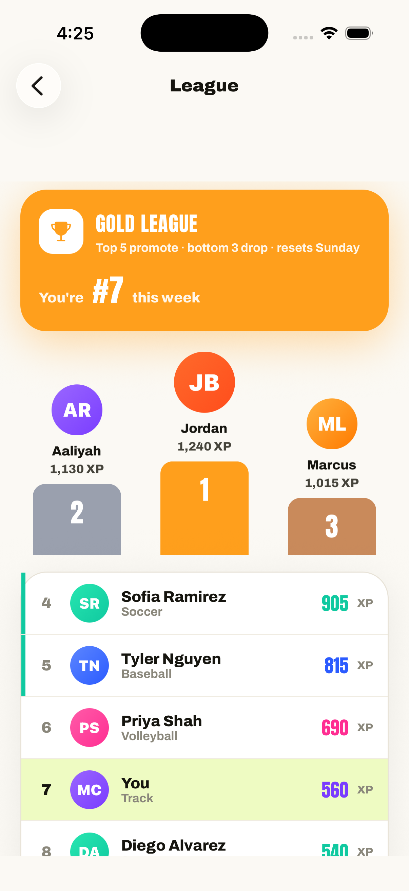

# Verza

A sports-focused social networking app by **Ahmad Arrabee**, founder and developer.

**Current stage: final testing.**

**Waitlist:** [Join the Verza waitlist](https://verza-pearl.vercel.app/).

Verza brings athlete profiles, sports updates, recruiting opportunities, clubs, and competitions into one mobile app. This portfolio shares selected screenshots and source files from the project. The full development repository remains private.

## What I built

The app includes interfaces and application code for:

- Sharing sports updates, photos, videos, and personal records.
- Building athlete profiles, following other users, and messaging.
- Discovering recruiting opportunities and managing applications.
- Creating clubs, leagues, and tournaments.
- Tracking profile completion, experience points, and achievements.

Verza is still in final testing, and a release date has not been confirmed.

## Screenshots

Development screenshots taken from the project repository:

| Profile and achievements | Personal shortcuts | Leaderboard preview |
| --- | --- | --- |
|  |  |  |

The leaderboard contains fixed sample entries. Names, scores, ranks, and achievement values shown here are interface examples, not evidence of adoption or real-world outcomes.

## Technology

| Part | Technology |
| --- | --- |
| Mobile app | React Native, Expo, TypeScript |
| Navigation | Expo Router |
| Backend | Supabase Auth, PostgreSQL, Storage, Realtime |
| Interface animation | React Native Reanimated, React Native SVG |
| Native interaction | Expo Haptics |

## Selected code

- [PressableScale](samples/components/ui/PressableScale.tsx): reusable press feedback with animation and optional haptics.
- [ProgressRing](samples/components/ui/ProgressRing.tsx): animated circular progress display.
- [Theme](samples/constants/theme.ts) and [colours](samples/constants/colors.ts): shared interface styling.
- [Haptics](samples/lib/haptics.ts): platform-aware interaction feedback.

These are selected source samples, not a standalone installation of the app. See the [technical overview](docs/TECHNICAL_OVERVIEW.md) and [source notes](samples/README.md).
